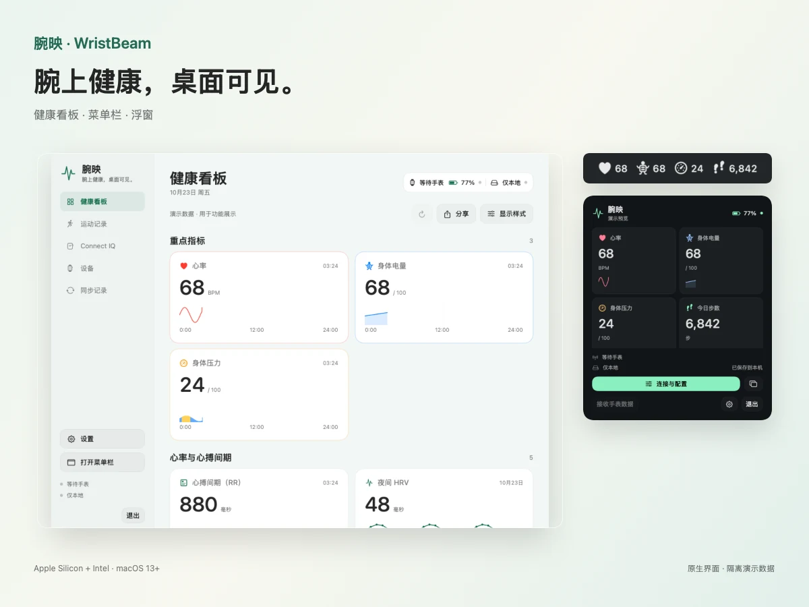

# 腕映 · WristBeam

在 Mac 上连接佳明手表，查看健康与运动数据。原始文件保存在本机，也能通过 MCP 和 API 接入 AI 助手或自己的工具。

[English](README.md) · [简体中文](README.cn.md) · [日本語](README.ja.md) · [한국어](README.ko.md) · [Русский](README.ru.md)

**[下载 macOS 版](https://github.com/kongdayan/wristbeam/releases/latest/download/WristBeam-macOS-universal.zip)** · [版本记录](CHANGELOG.md) · [反馈问题](https://github.com/kongdayan/wristbeam/issues)

需要 macOS 13 或更新版本。统一使用 Universal 安装包，Intel 和 Apple 芯片的 Mac 都能用，无需选择版本。

## 开始使用

1. 下载并解压，把 **WristBeam.app** 放到 **应用程序** 文件夹。
2. 打开 **设备 → 连接**，按页面引导准备手表，允许蓝牙访问并完成配对。
3. 进入 **健康看板** 查看可用数据；在 **设置** 中选择菜单栏和浮窗显示的指标。

只在本机使用手表数据，无需登录云账号。需要查看佳明云端历史或上传文件时，再到 **设备 → 设备账号** 登录，并在 **同步记录** 中选择同步方式。

[连接与使用指南](docs/SETUP.md)。当前安装包使用临时签名，尚未经过 Apple 公证。

## 能做什么

- **本地保存数据。** 通过蓝牙接收手表生成的运动、健康 FIT 原始文件，在 Mac 上保存和导出；按需开启佳明云同步。
- **接入 AI 与自动化。** 通过只读 MCP、HTTP/HTTPS API 或 Python SDK 查询已缓存的健康与运动数据，也可以配置 Webhook。集成默认关闭，按需启用。
- **随时查看身体状态。** 在看板、菜单栏或浮窗查看心率、身体电量、压力、步数等指标，以及可用的历史趋势。
- **查看运动记录。** 浏览历史训练、统计和图表，按数据情况导出 JSON、TCX、GPX 或原始文件。
- **管理表盘。** 搜索 Connect IQ 表盘，通过蓝牙安装并修改支持的表盘设置。能否切换当前表盘，取决于手表是否提供相应控制。

## 设备兼容性

目前已实机验证 **Instinct 2 Solar**。其他佳明型号与固件需要逐一验证；可用指标也取决于手表和数据来源。睡眠等仅来自云端的记录，需要连接云账号。

[支持的设备](docs/DEVICES.md) · [可用指标](docs/METRICS.md) · [验证范围](VERIFICATION.md)

## 文档与贡献

- [安装、连接与常见问题](docs/SETUP.md)
- [Connect IQ 表盘](docs/CONNECTIQ.md)
- [MCP、API 与 Python SDK](docs/developer/API.md)
- [本地开发与贡献](CONTRIBUTING.md) · [安全问题](SECURITY.md)
- [更多截图](docs/SHOWCASE.md) · [更新记录](CHANGELOG.md)

项目采用 [MIT 开源协议](LICENSE)。欢迎反馈设备兼容情况、修复问题或参与翻译。
