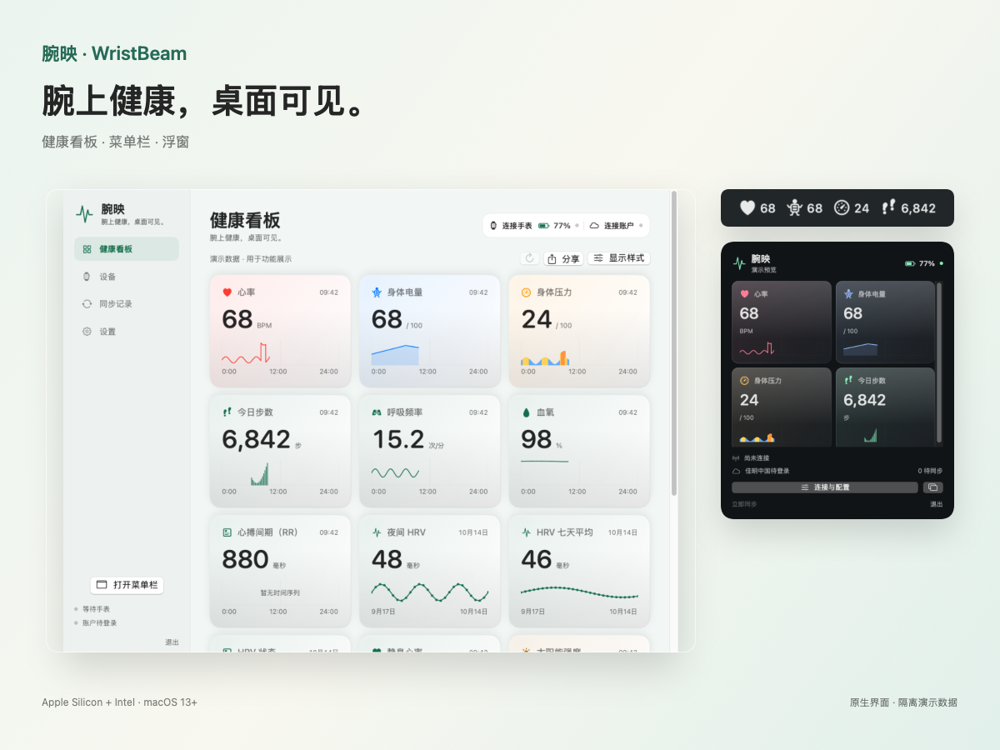
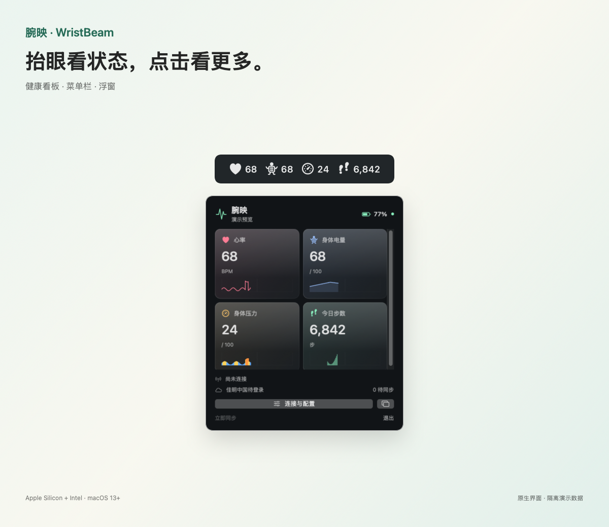
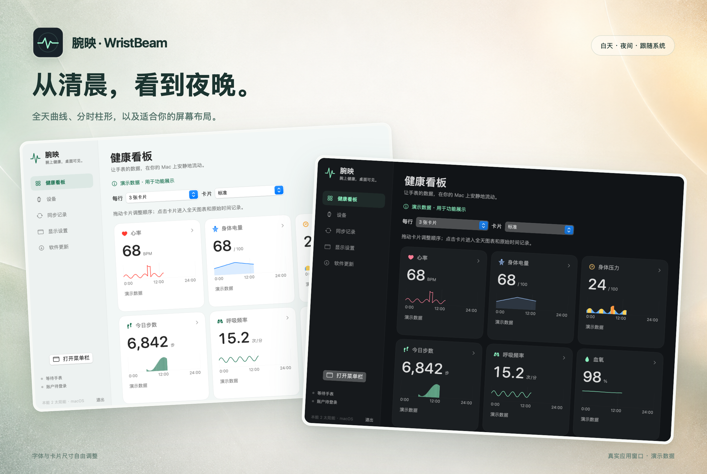
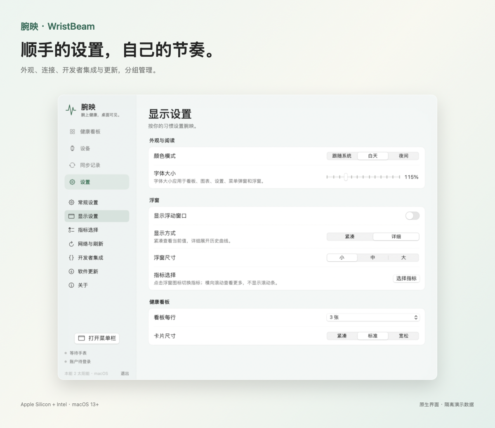
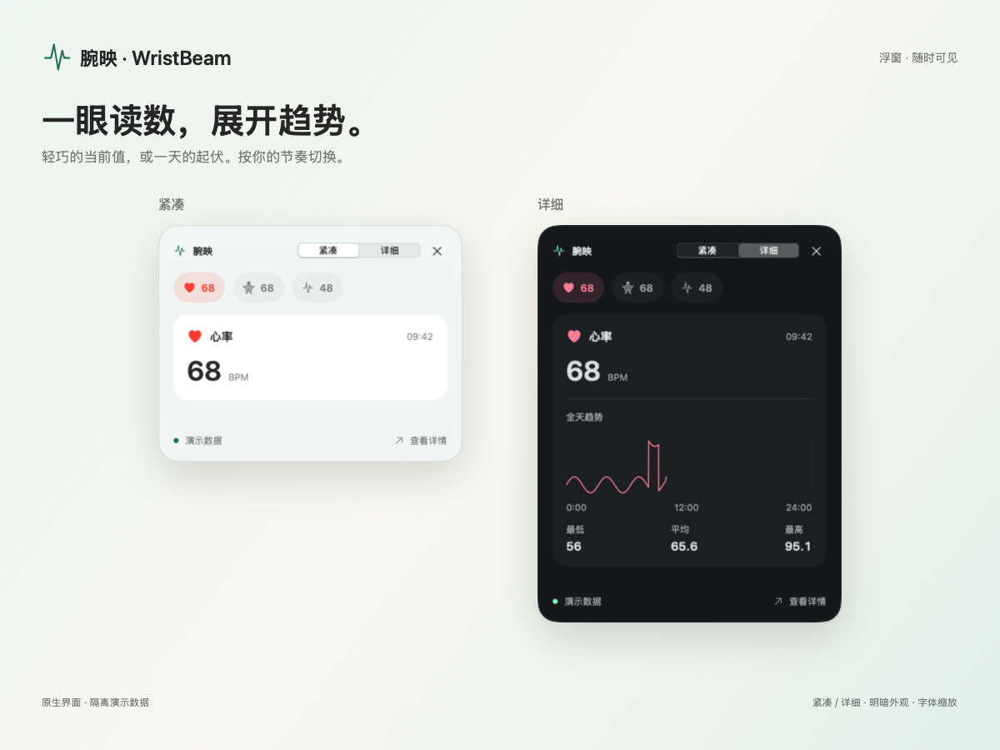
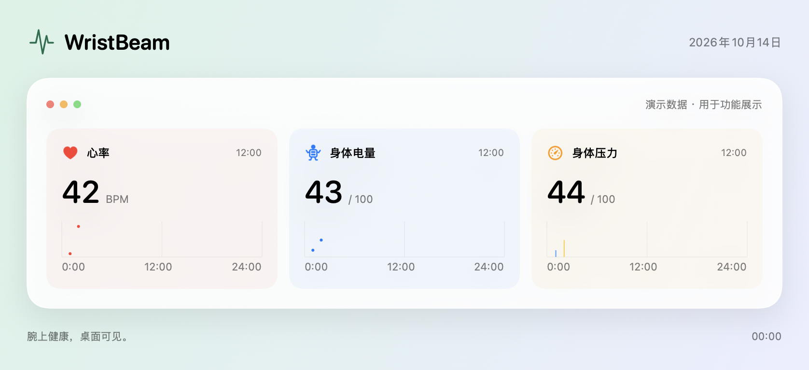

# 腕映 · WristBeam

Mac 有电量条，人也该有。

[English](README.md) · [简体中文](README.cn.md) · [日本語](README.ja.md) · [한국어](README.ko.md) · [Русский](README.ru.md)

**佳明手表 → Mac → 佳明云，手机 App 可以休息了。**

人已经坐在 Mac 前面，手表也戴在腕上，同步数据却还要摸出手机、打开 App，再回到电脑。我就是不想多走这一步，于是写了腕映：让手表直接通过蓝牙连接 Mac，把运动和健康数据同步到佳明云，也把身体状态搬到每天盯着的屏幕上。

- **让手机少上一个班。** Mac 直连支持的佳明手表，无需手机 App 中转，即可同步手表中的运动与健康文件到佳明中国或国际云。
- **给自己也装个电量条。** 心率、身体电量、压力、步数等指标放进菜单栏、浮窗和健康看板，随时查看数值与全天趋势。
- **让 AI 除了算 Token，也关心一下你。** 通过 MCP 把已同步的健康指标接入 AI 助手，问问「昨晚睡得怎么样」「今天身体电量如何」。还有 HTTP/HTTPS API、Python SDK 和 Webhook，方便开发自己的玩法。

电脑电量低了知道充，人电量低了还在开会。至少现在，你和你的 AI 都能看见。

**在 Mac 上换表盘。** 浏览 Connect IQ 表盘、保存官方安装包和预览图，通过蓝牙安装，并编辑支持的表盘设置，保存后回读确认。

[Connect IQ 表盘](docs/CONNECTIQ.md) · [接入你的 AI](docs/developer/API.md) · [支持的设备](docs/DEVICES.md) · [可用指标](docs/METRICS.md)

[下载](https://github.com/kongdayan/wristbeam/releases/latest) · [反馈与设备支持](https://github.com/kongdayan/wristbeam/issues) · [参与贡献](CONTRIBUTING.md) · [版本记录](CHANGELOG.md)

## 展示

真实应用界面，使用隔离演示数据。[原始截图与制作说明](docs/SHOWCASE.md)。

## 功能

- 在菜单栏、浮窗和看板独立选择指标，整组选取、搜索、拖动排序，调整字体与布局。
- **云不是必选项。** 无需云账号也能接收手表数据；可停止全部佳明云访问，在本机暂存，随时导出 FIT + CSV 或以后补传。[本地模式](docs/SETUP.md)。
- **让 AI 知道你最近练了什么。** 在独立运动记录页浏览云端历史，打开即加载统计和图表，支持导出 JSON、TCX／GPX／原始文件，通过 MCP 查询本地运动库；可设置摘要自动刷新频率。[运动接口](docs/developer/API.md#activity-library)。
- 紧凑立体卡片，标题旁显示更新时间；右上角统一调整布局、指标与基础选择。
- 带壳图片分享整个看板、选中卡片或单个数值，支持浅色／深色、复制、保存和系统分享。
- 全天曲线、分时柱形、日期与时间范围、光标读数、原始记录；缺测留空。
- 正常 Garmin 蓝牙通道，交互配对教程，原 FIT 持久队列、去重与云同步。
- 白天／夜间／系统主题，中英应用界面，确认后自动升级。

只读 MCP、HTTP/HTTPS API、Python SDK 与签名 Webhook，在「设置 → 开发者集成」中配置。默认关闭。[开发者接口文档](docs/developer/API.md)。

## 设备支持

目前兼容 **Garmin（佳明）** 手表，实机验证型号见下表；后续可扩展其他品牌与设备。

| 手表 | 实时指标 | 原 FIT 与中国云 | 太阳能记录 | 状态 |
| --- | --- | --- | --- | --- |
| Instinct 2 Solar | ✓ | ✓ | ✓ | 真机验证 |
| Instinct 2 / 2S / 2X | 待验证 | 待验证 | 依具体型号 | 欢迎反馈 |
| fēnix / epix / Forerunner | 待验证 | 待验证 | 依具体型号 | 欢迎反馈 |
| Venu / vívoactive 与其他型号 | 待验证 | 待验证 | 依具体型号 | 欢迎反馈 |

支持取决于具体固件与开放通道；没有将整个系列视为已兼容。[支持矩阵与反馈方法](docs/DEVICES.md)。

## 可采集的数据

| 参数 | 数据来源 | 展示方式 |
| --- | --- | --- |
| 心率、身体电量、压力 | Garmin 蓝牙通知＋云端全天记录 | 实时读数、全天曲线 |
| 步数 | 蓝牙＋云端 | 累计值、分时新增柱形 |
| 呼吸、血氧 | 手表发出测量通知／云端记录 | 读数、全天趋势 |
| RR 心搏间期 | 蓝牙通知 | 毫秒读数；不是夜间 HRV 评分 |
| 夜间 HRV | 云端睡眠记录 | 夜间均值、七天平均、状态、基线与夜间曲线；缺失项留空 |
| 手表电池 | 佳明蓝牙协议 | 设备信息中的电池图标与百分比；变化通知 + 定时刷新 |
| 热量、楼层、强度分钟 | 手表／云端提供的字段 | 今日统计，部分支持分时数据 |
| 静息心率、睡眠时长与恢复统计 | 云端每日汇总 | 汇总值与相关趋势 |
| 手表天气 | Open-Meteo 或设备云账号 | 向手表下发实况、小时与每日预报；[设置与范围](docs/developer/WEATHER.md) |
| 太阳能强度 | 云端有效分钟记录 | 0–24 点曲线 |
| 日照、太阳能充电时长 | 有效光照分钟估算 | 标记为估算 |
| 运动与健康 FIT | 手表原文件 | 本地保留、云端上传 |

目录包含 **60 个健康指标与 1 个设备状态字段**；只显示已收到有效数据的项目，各型号提供的字段不同。[完整指标表与验证状态](docs/METRICS.md)。

## 安装

| Mac | 安装包 |
| --- | --- |
| Apple Silicon | [arm64](https://github.com/kongdayan/wristbeam/releases/latest/download/WristBeam-macOS-arm64.zip) |
| Intel | [x86_64](https://github.com/kongdayan/wristbeam/releases/latest/download/WristBeam-macOS-x86_64.zip) |
| 两种架构 | [Universal](https://github.com/kongdayan/wristbeam/releases/latest/download/WristBeam-macOS-universal.zip) |

要求 macOS 13+。解压，将应用放入可写的 Applications 文件夹。打开“设备 → 连接”，按引导准备手表，点击连接按钮后允许蓝牙访问；保持心率广播关闭。到“设备账号”选择中国／国际区域，在佳明官方页面登录，再到“同步记录”选择手动或自动同步。启动自动连接默认关闭，可在首次配对后主动开启。

当前为临时签名，尚未 Apple 公证。真实国际账户上传、其他固件、应用层加密与 native MLR / CoreTransfer 尚未验证或支持。Mac 休眠时不能即时同步，当前不提供系统桌面小组件。[验证范围](VERIFICATION.md)。

## 贡献与共享

欢迎提交 PR、翻译、设备兼容结果与功能建议。项目采用 **[MIT](LICENSE)**，允许使用、修改与分发，请保留许可证。WristBeam 是独立项目，与 Garmin 官方无隶属关系。

[开发与提交指南](CONTRIBUTING.md) · [安全报告](SECURITY.md) · [自动发布流程](docs/RELEASING.md)
