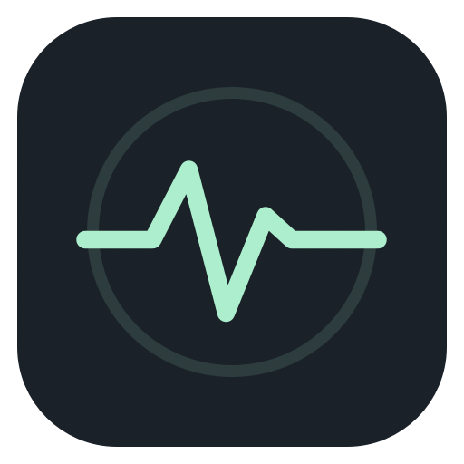
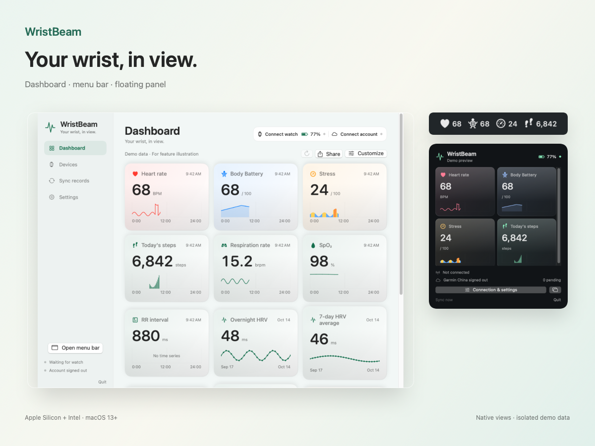
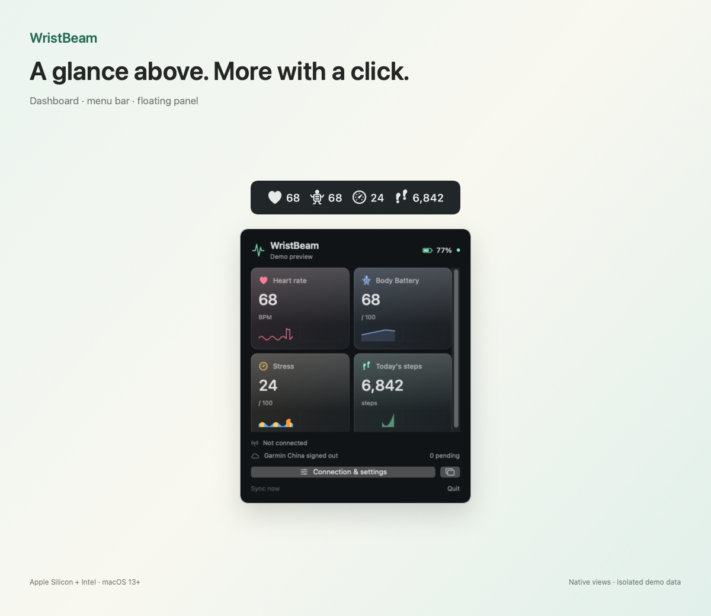
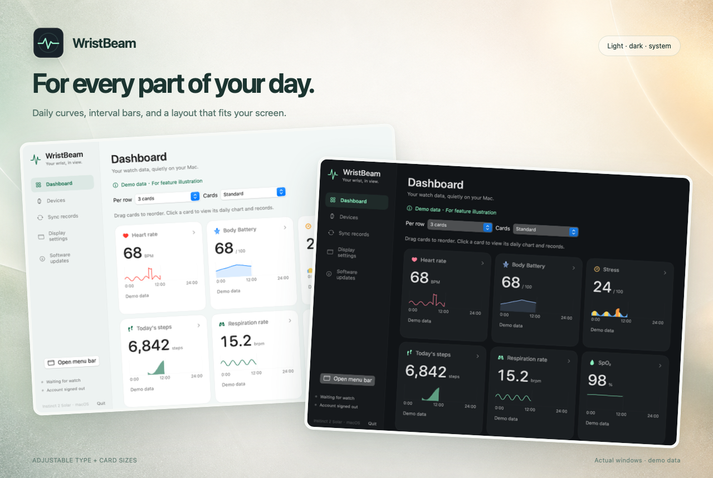
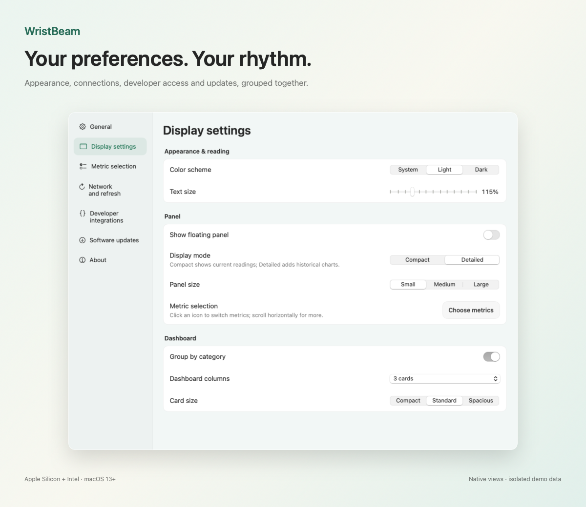
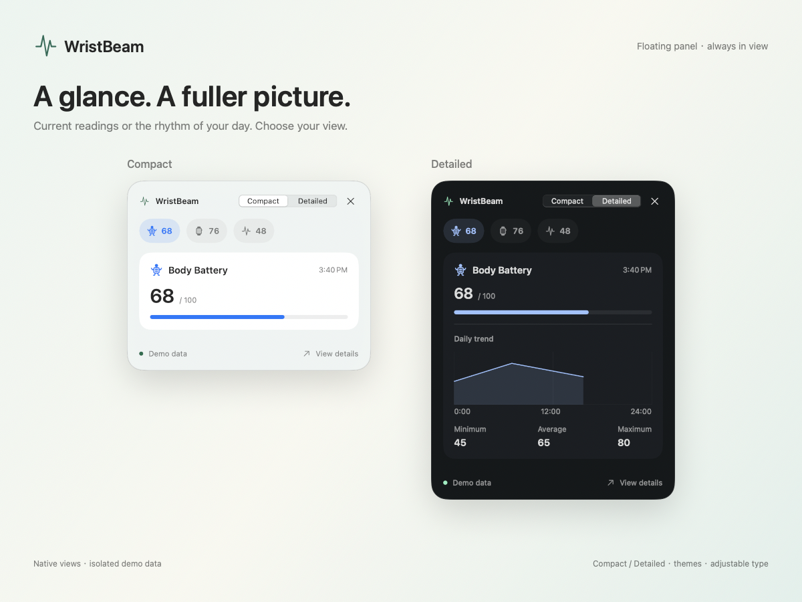

# WristBeam

Mac にバッテリー表示があるなら、自分にも。

[English](README.md) · [简体中文](README.cn.md) · [日本語](README.ja.md) · [한국어](README.ko.md) · [Русский](README.ru.md)

**Garmin → Mac → Garmin Connect。スマホアプリを経由せずに。**

Mac の前に座り、腕には時計がある。それなのに同期のたびにスマホを取り出してアプリを開く。そのひと手間をなくしたくて、WristBeam を作りました。時計を Bluetooth で Mac に直接つなぎ、アクティビティと健康データを Garmin Connect に同期します。

- **スマホにも休憩を。** 対応する Garmin ウォッチから Mac 経由で Garmin Connect 中国／グローバルへ同期。
- **自分のバッテリーをメニューバーに。** 心拍数、Body Battery、ストレス、歩数などを、メニューバーやフローティングパネル、日々のグラフで確認。
- **AI にも体調を伝える。** MCP で同期済みの健康指標を AI アシスタントに接続し、「昨夜の睡眠はどうだった？」と聞いてみましょう。HTTP/HTTPS API、Python SDK、Webhook で独自のツールも作れます。

トークンの残量だけでなく、あなたのエネルギーも気にかけてくれる AI へ。

[AI と接続](docs/developer/API.md) · [対応デバイス](docs/DEVICES.md) · [利用できる指標](docs/METRICS.md)

[ダウンロード](https://github.com/kongdayan/wristbeam/releases/latest) · [不具合・デバイス報告](https://github.com/kongdayan/wristbeam/issues) · [貢献](CONTRIBUTING.md) · [更新履歴](CHANGELOG.md)

## 画面

実際のアプリ UI に、独立したデモデータを表示しています。[元の画像と制作方法](docs/SHOWCASE.md)。

## 機能

- コンパクトな立体カードに更新時刻を表示。レイアウトと基本指標を一か所で設定し、看板全体・選択カード・単一値を明暗のフレーム付き画像としてコピー、保存、共有できます。
- メニューバー、パネル、ダッシュボードを個別に設定。グループ選択、検索、並べ替え、文字サイズとレイアウト調整。
- 日次曲線、時間帯別の棒グラフ、日付／時間範囲、カーソル値、元の記録。欠測は空白のまま。
- Garmin Bluetooth ペアリングガイド、元 FIT の永続キュー、重複排除とクラウド同期。
- ライト／ダーク／システムテーマ。アプリ UI は中国語・英語。更新は確認後に実行。

任意の開発者インターフェース：読み取り専用 MCP、HTTP/HTTPS API、Bearer キー、署名付き Webhook、Python SDK と stdio ブリッジ。[API ドキュメント](docs/developer/API.md)。初期状態では無効です。

## デバイス対応

現在は **Garmin** の時計に対応しています。実機検証済みモデルは下表をご覧ください。他ブランドやデバイスは今後の拡張対象です。

| 時計 | ライブ指標 | 元 FIT＋中国クラウド | ソーラー記録 | 状態 |
| --- | --- | --- | --- | --- |
| Instinct 2 Solar | ✓ | ✓ | ✓ | 実機確認済み |
| Instinct 2 / 2S / 2X | 未検証 | 未検証 | モデルによる | 報告歓迎 |
| fēnix / epix / Forerunner | 未検証 | 未検証 | モデルによる | 報告歓迎 |
| Venu / vívoactive・その他 | 未検証 | 未検証 | モデルによる | 報告歓迎 |

ファームウェアと利用可能なサービスに依存します。シリーズ全体の互換性は保証しません。[詳細と報告方法](docs/DEVICES.md)。

## 取得できるデータ

| 指標 | 取得元 | 表示 |
| --- | --- | --- |
| 心拍数・Body Battery・ストレス | Garmin 通知＋クラウドの日次記録 | 現在値、日次曲線 |
| 歩数 | Bluetooth＋クラウド | 日次合計、時間帯別増分 |
| 呼吸数・SpO₂ | 時計の測定通知／クラウド | 測定値、日次推移 |
| RR 間隔 | Bluetooth | ミリ秒。夜間 HRV スコアではありません |
| 夜間 HRV | クラウド睡眠記録 | 夜間平均・7日平均・状態・基準範囲・夜間グラフ。欠測値は補完しません |
| 時計の電池 | Garmin Bluetooth | デバイス情報に電池アイコンと残量を表示。変更通知と定期更新 |
| カロリー・階数・運動強度分 | 時計／クラウドが返す項目 | 日次集計、一部は時間帯別 |
| 安静時心拍数・睡眠時間・回復集計 | クラウドの日次集計 | 集計値、関連推移 |
| ソーラー強度 | 有効なクラウドの分単位記録 | 0〜24 時の曲線 |
| 日照／ソーラー充電時間 | 有効な入力分から推定 | 推定値として明示 |
| アクティビティ・健康 FIT | 時計の元ファイル | ローカル保存、クラウド送信 |

**60 個の健康指標と 1 個のデバイス状態フィールド**を用意しています。有効なデータを受信した項目だけを表示し、取得可否は時計によって異なります。[全一覧と検証状態](docs/METRICS.md)。

## インストール

| Mac | パッケージ |
| --- | --- |
| Apple Silicon | [arm64](https://github.com/kongdayan/wristbeam/releases/latest/download/WristBeam-macOS-arm64.zip) |
| Intel | [x86_64](https://github.com/kongdayan/wristbeam/releases/latest/download/WristBeam-macOS-x86_64.zip) |
| 両方のアーキテクチャ | [Universal](https://github.com/kongdayan/wristbeam/releases/latest/download/WristBeam-macOS-universal.zip) |

macOS 13 以降が必要です。展開して書き込み可能な Applications フォルダへ移します。「デバイス → 接続」で心拍ブロードキャストをオフにした時計を準備し、接続ボタンを押して Bluetooth を許可します。デバイスアカウントで中国／グローバルを選び、Garmin 公式ページでログイン後、同期履歴で手動／自動アップロードを選びます。起動時の自動接続は既定でオフです。ペアリング後に有効にできます。

アドホック署名で、Apple 公証は未実施です。実際のグローバルアカウント送信と他のファームウェアは未検証。アプリ層暗号化、native MLR / CoreTransfer、デスクトップウィジェットは未対応です。Mac のスリープ中は即時同期できません。[検証範囲](VERIFICATION.md)。

## 貢献と共有

PR、翻訳、デバイス検証、アイデアを歓迎します。**[MIT](LICENSE)** により、ライセンスを残して利用・変更・再配布できます。Garmin 公式とは関係のない独立プロジェクトです。

[開発・PR ガイド](CONTRIBUTING.md) · [安全性の報告](SECURITY.md) · [自動リリース](docs/RELEASING.md)
