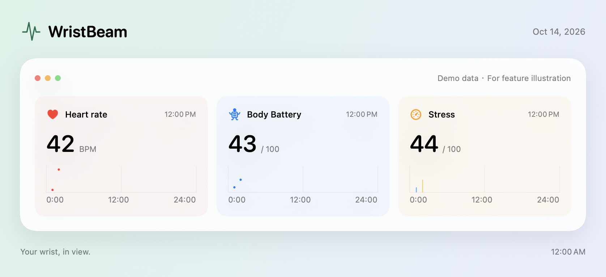

# WristBeam

Your Mac has a battery indicator. You deserve one too.

[English](README.md) · [简体中文](README.cn.md) · [日本語](README.ja.md) · [한국어](README.ko.md) · [Русский](README.ru.md)

**Garmin → Mac → Garmin Connect. No phone app in the middle.**

I wanted my watch to talk to the computer I was already sitting in front of. Instead, syncing meant reaching for my phone, opening another app, and then going back to my Mac. So I wrote WristBeam: a direct Bluetooth connection from wrist to desktop, with activity and health data syncing to Garmin Connect in the background.

- **Give your phone a day off.** Connect a supported Garmin watch directly to your Mac and sync its activity and health files to Garmin Connect China or Global.
- **Put your own battery in the menu bar.** Keep heart rate, Body Battery, stress, steps and more in view, with floating panels, daily charts and a customizable dashboard.
- **Let your AI check in on you.** Use MCP to make your synced health metrics available to an AI assistant. Ask “How was my sleep?” or “What does my energy look like today?” Build your own tools with the HTTP/HTTPS API, Python SDK and webhooks.

Your AI can already count tokens. Now it can ask how *you're* doing.

[Connect your AI](docs/developer/API.md) · [Supported devices](docs/DEVICES.md) · [Available metrics](docs/METRICS.md)

[Download](https://github.com/kongdayan/wristbeam/releases/latest) · [Issues & device reports](https://github.com/kongdayan/wristbeam/issues) · [Contribute](CONTRIBUTING.md) · [Changelog](CHANGELOG.md)

## A closer look

Real app UI with isolated demo data. [Original captures and artwork notes](docs/SHOWCASE.md).

## Features

- **Keep it on your Mac.** Watch data works without a cloud account. Pause all Garmin cloud access, keep local files, then export FIT + CSV or upload later. [Local mode](docs/SETUP.md).
- **Let your AI remember your workouts.** Browse the Activities sidebar, open a workout to load its statistics and charts, export JSON / TCX / GPX / original files, and query cached workouts over MCP. Optional scheduled summary refresh. [Activity API](docs/developer/API.md#activity-library).
- Compact dimensional cards with timestamps beside the title. Customize layout and essentials in one panel; share the dashboard, selected cards or a single value as a framed image in light or dark, with copy, save and native sharing.
- Independent menu bar, panel and dashboard selections, group toggles, search, drag ordering, adjustable text and layout.
- Daily curves, interval bars, date/time ranges, cursor readings and original records. Gaps remain empty.
- Garmin Bluetooth pairing guide, persistent original-FIT queue, deduplication and cloud sync.
- Light/dark/system themes, Chinese/English app UI, and updates that require confirmation.

Opt-in read-only MCP, HTTP/HTTPS API, Python SDK and signed webhooks in Settings → Developer integrations. [Developer API](docs/developer/API.md).

## Device support

Currently compatible with **Garmin** watches; verified models are listed below. Other brands and devices may be added later.

| Watch | Live metrics | Original FIT + China cloud | Solar records | Status |
| --- | --- | --- | --- | --- |
| Instinct 2 Solar | ✓ | ✓ | ✓ | Device verified |
| Instinct 2 / 2S / 2X | Unverified | Unverified | Model dependent | Reports welcome |
| fēnix / epix / Forerunner | Unverified | Unverified | Model dependent | Reports welcome |
| Venu / vívoactive and other models | Unverified | Unverified | Model dependent | Reports welcome |

Support depends on firmware and available services; an entire family is not assumed compatible. [Detailed matrix and reporting](docs/DEVICES.md).

## Data you can collect

| Metric | Source | Presentation |
| --- | --- | --- |
| Heart rate, Body Battery, stress | Garmin notifications + daily cloud records | Current readings, daily curves |
| Steps | Bluetooth + cloud | Daily total, interval increments |
| Respiration, SpO₂ | Measurements emitted by watch / cloud | Readings, daily trends |
| RR intervals | Bluetooth | Milliseconds; not an overnight HRV score |
| Overnight HRV | Cloud sleep records | Nightly / seven-day average, status, baseline and night chart; missing fields stay empty |
| Watch battery | Garmin Bluetooth protocol | Battery icon and percentage beside device status; change notifications + periodic refresh |
| Calories, floors, intensity minutes | Fields supplied by watch / cloud | Daily totals; some interval data |
| Resting heart rate, sleep duration, recovery summaries | Daily cloud summary | Summary values and related trends |
| Watch weather | Open-Meteo or device cloud account | Current / hourly / daily weather sent to the watch; [setup and limits](docs/developer/WEATHER.md) |
| Solar intensity | Valid cloud minute records | Midnight-to-midnight curve |
| Sunlight / solar charging duration | Estimated from valid input minutes | Explicitly labeled estimates |
| Activity and health FIT | Original watch files | Retained locally, uploaded to cloud |

The catalog has **60 health metrics and one device-status field**. Only metrics with valid received data appear; availability varies by watch. [Full catalog and evidence](docs/METRICS.md).

## Install

| Mac | Download |
| --- | --- |
| Apple Silicon | [arm64](https://github.com/kongdayan/wristbeam/releases/latest/download/WristBeam-macOS-arm64.zip) |
| Intel | [x86_64](https://github.com/kongdayan/wristbeam/releases/latest/download/WristBeam-macOS-x86_64.zip) |
| Either architecture | [Universal](https://github.com/kongdayan/wristbeam/releases/latest/download/WristBeam-macOS-universal.zip) |

Requires macOS 13+. Extract and move the app to a writable Applications folder. Open Devices → Connection, prepare the watch with heart-rate broadcast off, then click a connection button to allow Bluetooth. Choose China/Global in Device account and sign in on Garmin's official page; choose manual or automatic uploads in Sync records. Connecting at launch is off by default and can be enabled after pairing.

Ad hoc signed; not Apple notarized. Real Global uploads and other firmware remain unverified. Application-level encryption, native MLR / CoreTransfer and desktop widgets are unsupported. The Mac cannot sync immediately while asleep. [Verification scope](VERIFICATION.md).

## Contribute and share

PRs, translations, device results and ideas are welcome. **[MIT](LICENSE)** permits use, modification and redistribution with the license retained. This independent project is not affiliated with Garmin.

[Development & PR guide](CONTRIBUTING.md) · [Security reports](SECURITY.md) · [Automated releases](docs/RELEASING.md)
