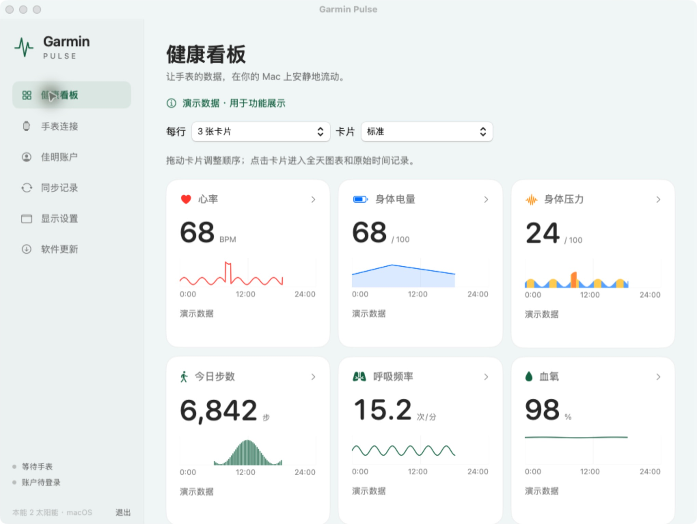
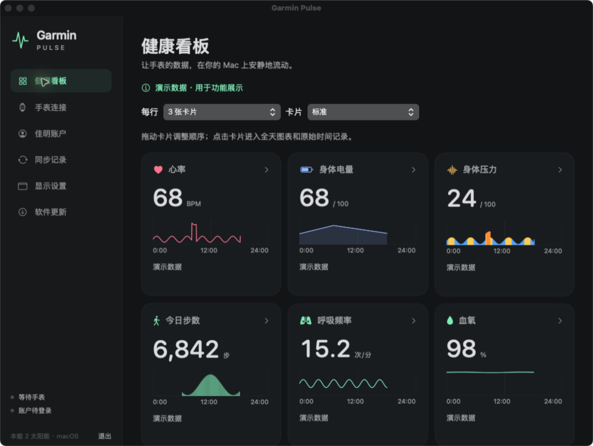
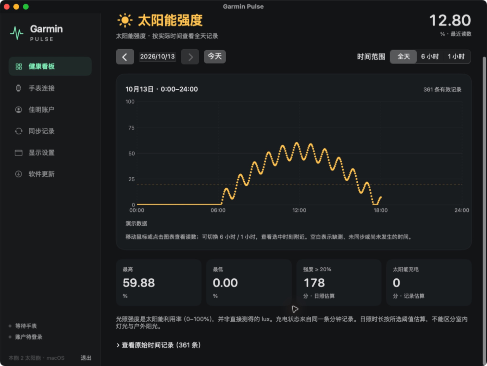
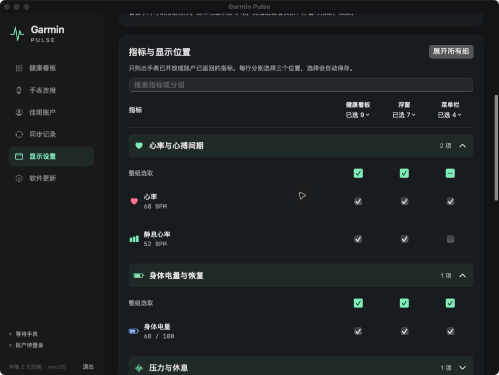
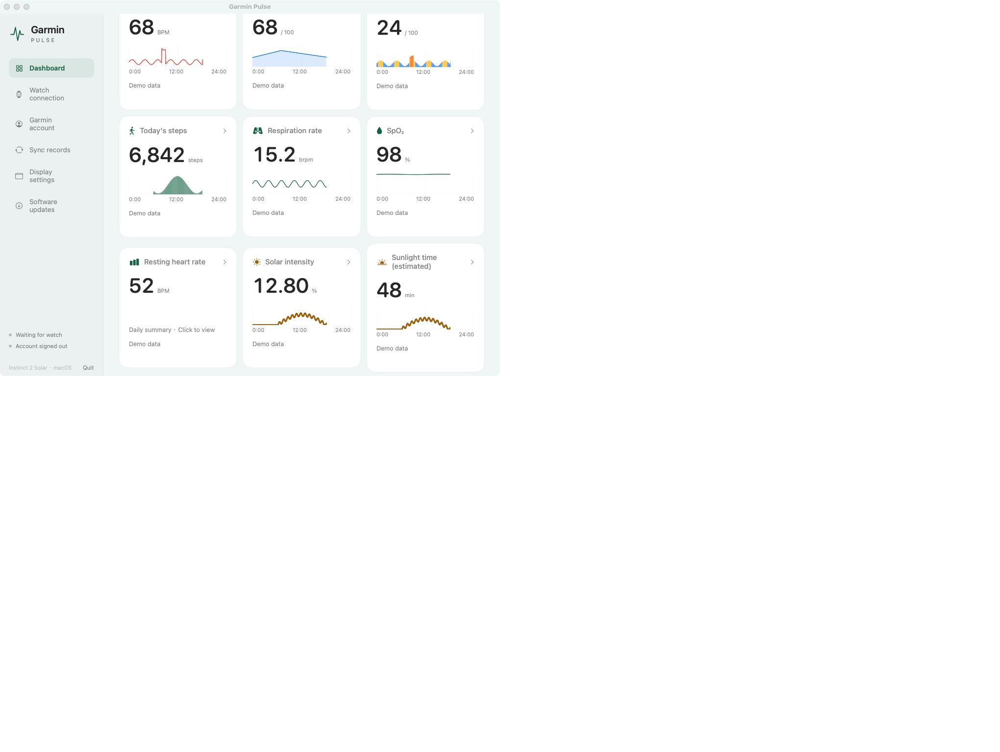

# Garmin Pulse

[English](README.en.md) · [下载安装包](https://github.com/kongdayan/garmin-pulse/releases/latest) · [版本记录](CHANGELOG.md)

在 Mac 菜单栏、浮窗和健康看板查看 Garmin 手表数据。通过正常佳明蓝牙通道接收实时指标，下载手表原始 FIT，持续同步到 Garmin Connect 中国或国际账户。已在 Instinct 2 Solar 上验证中国账户的实时读数与原 FIT 上传。

## 界面展示

以下为 **computer-use 拍摄的真实 macOS 窗口**。展示使用隔离的演示实例，所有数值为模拟数据，不含个人账户或手表记录。

| 健康看板 · 白天 | 健康看板 · 夜间 |
| --- | --- |
|  |  |







## 安装与连接

1. 从 [Releases](https://github.com/kongdayan/garmin-pulse/releases/latest) 下载对应架构的 ZIP，解压后将 **Garmin Pulse.app** 放到你有写入权限的 Applications 文件夹。初始版本提供 Apple Silicon 安装包，要求 macOS 13 或更高。
2. 打开应用并允许蓝牙访问。应用从菜单栏继续运行，主窗口关闭后仍可同步。
3. 在手表长按 MENU → 手机 → 配对手机，靠近 Mac。若手机占用连接，暂时关闭手机蓝牙；保持心率广播关闭。
4. 在“手表连接”逐步扫描、选择设备、确认配对提示。界面分别验证蓝牙连接、佳明协议协商、实际实时读数、文件通道，配对成功不直接等同于同步就绪。
5. 在“佳明账户”选择中国或国际区域，在佳明官方页面登录。软件保留授权令牌并自动续期，不保存密码。

当前安装包为临时签名，尚未做 Developer ID 签名或 Apple 公证。不同固件的应用层加密、native MLR / CoreTransfer 文件通道尚未支持；国际账户的隔离与路由已测试，真实国际账号登录上传尚待实测。

## 指标与图表

- **只列出已取得有效数据的指标**，未提供的项目不出现在选择表里。暂时断线不清除已有选择，过期读数显示 `—` 和更新时间。
- 一张分组表同时勾选 **健康看板 / 浮窗 / 菜单栏**，支持搜索、标题整行展开、整组全选/取消。点击指标名称切换看板，三列分别独立选择。
- 指标包括心率、身体电量、压力、步数、呼吸、血氧、RR、热量、楼层及账户返回的每日统计。RR 是心搏间期，不当作夜间 HRV 评分。
- 全天图使用实际时间，缺测和未来时段留空。光照与身体电量使用曲线，压力按区间着色，步数与楼层使用分时新增柱形。
- 点击卡片进入详情，可切换日期、全天 / 6 小时 / 1 小时，移动鼠标看读数，展开原始时间表。汇总值进入对应趋势；静息心率进入心率曲线，不会跳到光照。
- 日照和太阳能充电时长按有效分钟记录估算，明确标记估算；光照不能区分室内灯光和户外阳光。
- 看板每行自动或 1–4 张、三种卡片大小，拖动调整顺序；浮窗三种尺寸，可拖动和滚动。字体 100%–160%，支持白天、夜间和跟随系统。
- **简体中文 / English / 跟随系统**，切换即时生效。当前界面不提供系统桌面小组件。

实时更新依照手表通知。云端指标和曲线默认每 5 分钟刷新，可选 1/5/15 分钟；上传完成后立即刷新。图形与游标分开绘制，选点使用二分查找。

## 同步与更新

原 FIT 和元数据先保存，再确认蓝牙末块；按内容去重并持久保存上传队列。支持自动接收、手动同步最近一次运动、导入原 FIT 和监控 FIT 文件夹。软件不会改写账户 GUID、删除手表文件或伪造健康文件上传。

中国与国际账户的会话、上传任务、原文件回放和图表缓存分别隔离，跨区域服务地址拒绝访问。HTTP 201 接收、409 已存在、202 处理中分别呈现。

“软件更新”连接本仓库的 [GitHub Releases API](https://docs.github.com/en/rest/releases/releases#get-the-latest-release)，无需 GitHub 登录。启动后及运行期间每 12 小时检查一次；发现新版先提示，**确认后才下载和升级**。安装前校验 GitHub 的 SHA-256、ZIP 路径与大小、应用身份、版本、架构及签名；完成后重启，保留前一版应用和全部账户/设置/数据。同步文件期间暂停升级。下载与校验失败会保持当前应用。

电脑休眠、关机或手表离开蓝牙范围期间不能即时同步；恢复连接后处理保留的任务。没有注册系统登录启动项，需打开软件运行。

## 数据保留

数据只放在 `~/Library/Application Support/GarminPulse/`，私有目录 `0700`，凭据、FIT、日志与状态文件 `0600`。授权按区域保存在 `auth/`，原文件在 `Received/` 和 `UploadQueue/`，本地读数在 `Telemetry/`，曲线在 `Charts/`。这些内容不进入仓库、安装包或更新请求。

演示实例使用独立的 `GarminPulsePreview/` 和独立设置域，禁用蓝牙与云上传。关闭演示不会改动真实账户和显示选择。

## 开发与验证

```sh
python3 scripts/test-core.py
python3 scripts/check-localization.py
zsh scripts/build.sh
python3 scripts/test-updater.py
```

67 项协议/云端/显示/语言/更新策略检查，9 项真实安装包检查；Release 构建执行严格签名校验。测试可使用 Command Line Tools，完整 Xcode 的 XCTest 可通过 `swift test` 运行。GitHub Actions 重复执行同一套检查。[验证范围](VERIFICATION.md)记录真实设备和界面测试的结果与边界。

演示构建：`zsh scripts/build-preview.sh`，随后在 Finder 打开 `dist/Garmin Pulse Demo.app`。系统小组件的源码仅供后续开发，当前发布包不嵌入扩展。

版本号在 `VERSION`。后续发布前运行全部检查，构建 ZIP，上传对应架构安装包与 SHA-256 到新版本 Release；已安装软件会检测正式新版本。

本项目是独立的 macOS companion，与 Garmin 官方没有隶属关系。
