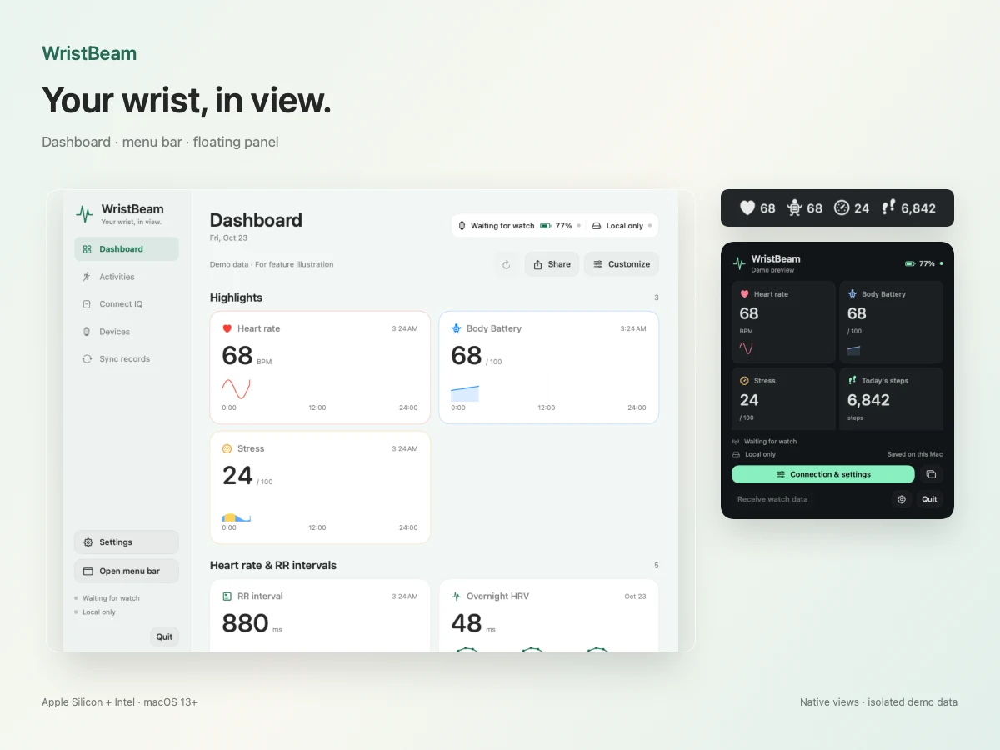

# WristBeam

Приложение для macOS, которое подключает часы Garmin к Mac по Bluetooth. Храните данные здоровья и тренировок на компьютере и используйте их в своих инструментах или ИИ-ассистенте через MCP и API.

[English](README.md) · [简体中文](README.cn.md) · [日本語](README.ja.md) · [한국어](README.ko.md) · [Русский](README.ru.md)

**[Скачать для macOS](https://github.com/kongdayan/wristbeam/releases/latest/download/WristBeam-macOS-universal.zip)** · [Изменения](CHANGELOG.md) · [Сообщить о проблеме](https://github.com/kongdayan/wristbeam/issues)

Требуется macOS 13 или новее. Один Universal-пакет подходит для Mac с Apple Silicon и Intel.

## Начало работы

1. Скачайте и распакуйте ZIP, затем перенесите **WristBeam.app** в папку **Программы**.
2. Откройте **Devices → Connection**, следуйте инструкции, разрешите Bluetooth и выполните сопряжение с часами.
3. Откройте **Dashboard**, чтобы увидеть доступные данные. Показатели строки меню и плавающей панели выбираются в **Settings**.

Для локального использования данных часов вход не нужен. Чтобы читать историю Garmin Connect или отправлять файлы в облако, подключите аккаунт в **Devices → Device account** и выберите способ синхронизации в **Sync records**.

[Подключение и настройка](docs/SETUP.md). Текущая сборка подписана ad hoc и не прошла нотариальное заверение Apple.

## Возможности

- **Локальное хранение.** Получайте исходные FIT-файлы тренировок и здоровья с часов, сохраняйте и экспортируйте их на Mac. Синхронизация с Garmin Connect необязательна.
- **ИИ и автоматизация.** Запрашивайте сохранённые данные через MCP только для чтения, HTTP/HTTPS API или Python SDK. Для своих процессов можно настроить вебхуки. Интеграции работают только после включения.
- **Здоровье в течение дня.** Смотрите пульс, Body Battery, стресс, шаги и доступные графики на панели, в строке меню или плавающем окне.
- **История тренировок.** Открывайте статистику и графики, экспортируйте JSON, TCX, GPX или исходные файлы при наличии данных.
- **Управление циферблатами.** Ищите в Connect IQ, устанавливайте по Bluetooth и редактируйте поддерживаемые настройки. Смена активного циферблата зависит от команд, которые предоставляют часы.

## Совместимость

**Instinct 2 Solar** проверен на реальном устройстве. Другие модели Garmin и прошивки требуют отдельной проверки. Доступные показатели зависят от часов и источника данных; для облачных записей нужен подключённый аккаунт.

[Поддерживаемые устройства](docs/DEVICES.md) · [Доступные показатели](docs/METRICS.md) · [Область проверки](VERIFICATION.md)

## Документация и участие

- [Настройка и решение проблем](docs/SETUP.md)
- [Циферблаты Connect IQ](docs/CONNECTIQ.md)
- [MCP, API и Python SDK](docs/developer/API.md)
- [Разработка и участие](CONTRIBUTING.md) · [Безопасность](SECURITY.md)
- [Другие снимки экрана](docs/SHOWCASE.md) · [Изменения](CHANGELOG.md)

Проект доступен по [лицензии MIT](LICENSE). Приглашаем отчёты о совместимости, исправления и переводы.
