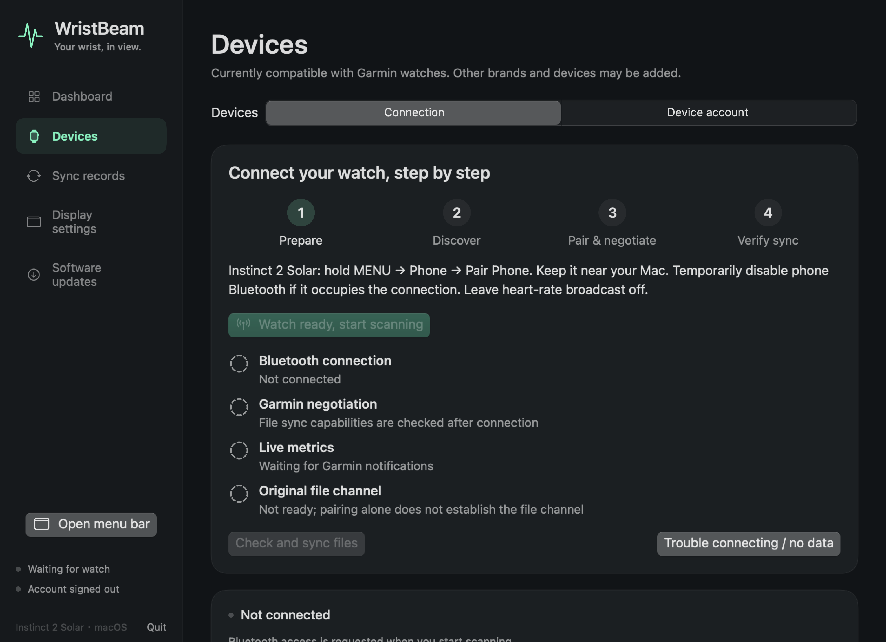
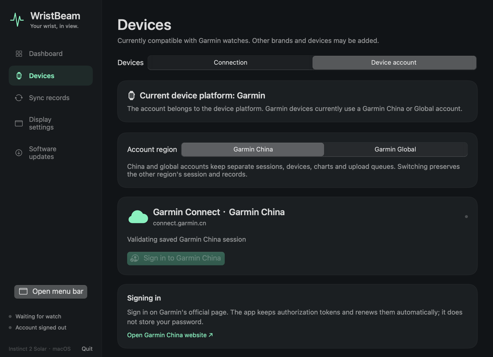

# Device support

WristBeam currently connects Garmin watches. The app is an independent health-data companion; other brands and device adapters are future extensions, not available features.

A row is verified only for the recorded device/firmware and observed capability. Discovery or successful pairing alone does not prove fresh metrics or file transfer.

| Device | Pairing | Fresh notifications | Original FIT download | China upload | Daily charts / solar | Evidence |
| --- | --- | --- | --- | --- | --- | --- |
| Instinct 2 Solar | Verified | Verified | Verified | Verified | Verified | 2026-10-13, [verification record](../VERIFICATION.md); exact firmware was not recorded |
| Instinct 2 / 2S / 2X | Unverified | Unverified | Unverified | Unverified | Unverified | Community report needed |
| fēnix / epix / Forerunner | Unverified | Unverified | Unverified | Unverified | Unverified | Community report needed |
| Venu / vívoactive / other Garmin models | Unverified | Unverified | Unverified | Unverified | Unverified | Community report needed |

Solar availability depends on the exact model. No solar hardware capability is assumed by this table. Global account routing/isolation has automated coverage, but real Global authentication/uploads remain unverified.

The sidebar has one Devices entry. Connection and Device account are separate tabs; the supported device platform determines the account. At present this means Garmin China or Global, with separate authorization/data per region.

## Report a result

Use the [device support form](https://github.com/kongdayan/wristbeam/issues/new?template=device_support.yml). Include the exact model, firmware, app version, macOS/architecture, account region and separate outcomes for:

1. Pairing and protocol readiness.
2. Newly received notification timestamps, with metric names only.
3. Original FIT download and cloud acceptance.
4. Daily charts and solar records, if supplied.

Do not attach account identifiers, serials, raw FIT, precise location or health records. Share sanitized status/errors or demo screenshots. A maintainer can link the report and add a separate tested-firmware row after reviewing the evidence.

## Known limits

Application-level encryption and native MLR / CoreTransfer are unsupported. The app detects unsupported file channels instead of claiming sync readiness. An unavailable metric is hidden from new selections; valid cached choices are retained and stale values are labeled.

[Full metric catalog](METRICS.md) · [Contributing](../CONTRIBUTING.md)
