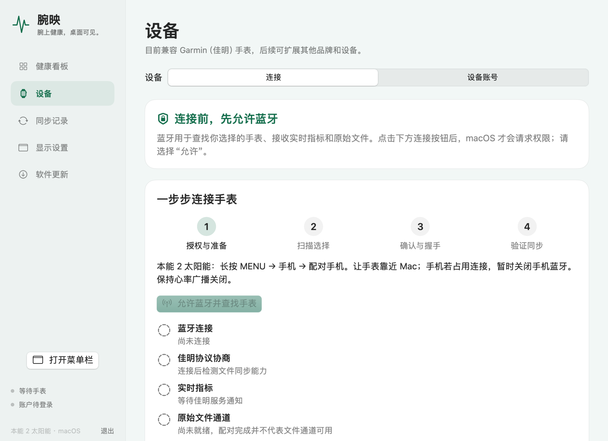

# 连接与权限引导 · Setup

## 中文

1. 打开应用，进入 **设备 → 连接**。打开软件和浏览设备页都不会申请蓝牙或扫描手表。
2. 首次配对：手表长按 MENU → 手机 → 配对手机，关闭心率广播；手机占用连接时，暂时关闭手机蓝牙。点击 **允许蓝牙并查找手表**，在 macOS 提示中允许访问，再选择手表、核对配对码。已保存的手表可直接点击 **连接已配对手表**，无需每次忘记或重新配对。
3. 允许蓝牙后，分别检查蓝牙连接、佳明数据通道、实时读数和文件通道。单独显示“已连接”不能证明原始文件同步已经就绪。没有数据时展开 **连接不上 / 没有数据**。
4. 到 **设备账号** 选择手表绑定的中国或国际账户区域，在佳明官方页面登录。同一区域、同一账户才能核对文件归属；关联设备应与你的手表一致。
5. 到 **同步记录** 选择手动或自动上传。实时读数留在本机，云端接收手表生成的原始运动与健康 FIT。新用户默认手动同步；旧版已保存的选择以及已配对用户原先的自动同步默认值保留。
6. 在 **显示设置** 分别选健康看板、浮窗和菜单栏的指标，调整字体、日夜主题和刷新。新用户默认不弹出空浮窗，按需开启。

**拒绝蓝牙**：在系统设置 → 隐私与安全性 → 蓝牙允许 WristBeam，再回到连接页。受到系统策略限制时需由设备管理员处理；设备账号与 FIT 导入仍可使用。临时签名的新构建可能需要重新允许访问，应用只在主动连接时请求。

**后台运行**：关闭主窗口后，应用继续在菜单栏运行。退出应用、Mac 休眠或关机会暂停即时同步。启动自动连接默认关闭；完成授权与配对后可主动开启。断线重连只恢复你已主动建立的连接，手动断开后停止重连。

**文件夹监测**：选择的文件夹中新增 FIT 会进入本地队列；自动同步开启后上传到当前设备账号，关闭时等待手动同步。可在同步记录中停止监测。

**升级**：检查 GitHub 版本 → 查看版本说明 → 确认下载 → 校验与重启。正在传输时等任务完成；原有账户、数据和显示设置保留，上一版应用可供恢复。

## English

Open **Devices → Connection** before granting Bluetooth access. Opening the app or browsing this page never asks for access or starts scanning. Prepare the watch with heart-rate broadcast off, click **Allow Bluetooth and find watch**, allow the macOS request, then select and confirm your watch. A saved watch can use **Connect saved watch** without pairing again.

Check the connection, Garmin channel, live readings and original-file channel separately. Open the troubleshooting section if a channel has no data. In **Device account**, choose the region and account linked to your watch and sign in on Garmin's official page.

In **Sync records**, choose manual or automatic uploads. New profiles default to manual sync; existing choices and legacy paired users' automatic defaults are preserved. Live readings stay local; uploads contain original watch-generated FIT files. Folder monitoring applies only to the selected directory and can be stopped here.

Connecting at launch is a separate opt-in and requires previously granted access plus a saved watch. Reconnection restores only a connection you started; manual disconnect stops retries. Closing the window keeps the menu bar app running, while quitting or Mac sleep pauses immediate syncing. Configure the floating panel, display metrics, type size, themes and refresh in **Display settings**.

If Bluetooth is denied, enable WristBeam in System Settings → Privacy & Security → Bluetooth and retry. A system restriction needs the administrator's help. An ad hoc build may need renewed system authorization after an update. Updates ask for confirmation before download and wait for active transfers to finish.

See [Apple's Bluetooth authorization states](https://developer.apple.com/documentation/corebluetooth/cbmanagerauthorization) and [Garmin's Instinct 2 pairing instructions](https://www8.garmin.com/manuals/webhelp/GUID-31D23DBB-57C2-4DF7-A0C9-8D1A00AB4BE7/EN-US/GUID-4C14822E-F472-4C3A-B33C-BB50407ADDE5.html).
